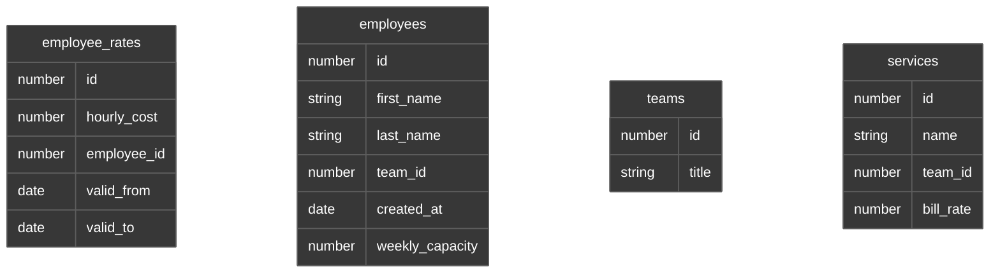
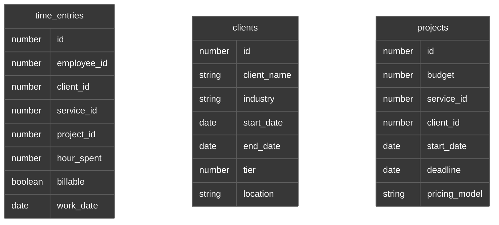
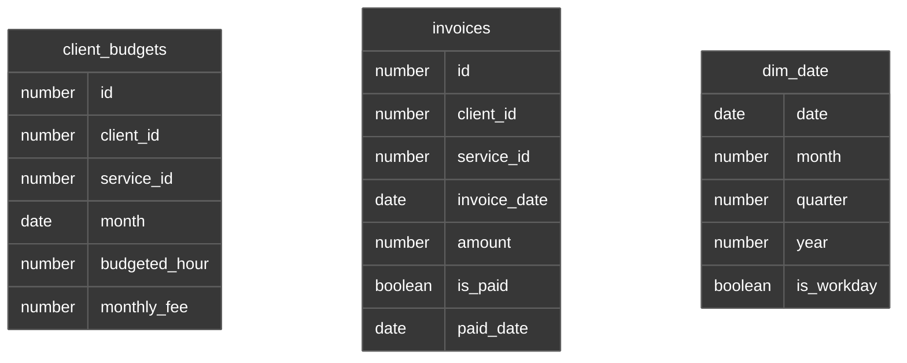

<!--
Before publishing:
1. Fill every {{}} in "Interesting findings" from the dashboard (3-month view), then sort each table by revenue.
2. Views section: swap the two SQL sketches for your real code, and paste the other four.
   Run this in the Neon SQL Editor for each view:  SELECT pg_get_viewdef('v_entry_cost', true);
3. Check the column names in the ERD against your real tables.
4. Optional: drag screenshots in on GitHub next to each feature.
Delete this comment when you're done.
-->

# Margin Hub

A dashboard that shows a digital agency which clients, services and people make money, and which ones lose it.

**Live demo: [https://margin-hub-tau.vercel.app](https://margin-hub-tau.vercel.app)**

## Overview

An agency can be busy every day and still not make money. Margin Hub helps the owner see which services actually turn a profit, which clients take more time than they pay for, and who on the team is overloaded or doesn’t have enough to do. Every hour logged is tied to a person and a client, so the numbers show what’s really going on.

## The problem

Most agencies lose money in the same few ways:

- **Scope creep.** A client sets a budget for a project, but the work ends up needing more hours than planned. Every hour costs the agency money, so after a while the project turns from a profit into a loss.
- **Busy and idle staff.** Most of the team works full-time, nine to five. Some people have more work than they can handle, while others have a lot of free time. Both cost the agency money.
- **Profitable and unprofitable clients.** A client can look fine on paper and still lose money. Some also pay late, and nobody notices.
- **Busy doesn’t mean profitable.** A service can bring in lots of work and still earn very little, while a simpler one ends up paying the bills.

It all comes down to one gap: what a client budgeted, what they actually paid, and what the work really cost.

## The questions that solve the problem

To close that gap, the owner needs answers to five questions:

| Question | What we measure | Where to look |
| --- | --- | --- |
| Which clients make money, and which cost more than they pay? | Profit and margin per client | Home, Clients |
| Which services bring in the most revenue, the most profit and the best margin? | Revenue, profit and margin by service | Services |
| Which teams bring in the most revenue, and how does their labour cost compare with their profit? | Revenue, labour cost and gross profit by team | Team |
| Who has too much work, and who doesn’t have enough? | Utilisation | Team |
| How is the agency doing overall, and how many active clients does it have? | Revenue, gross profit, margin and active clients over the last 3, 6 or 12 months | Home |

Here’s how each number is worked out:

| Metric | How it’s calculated |
| --- | --- |
| Revenue | What was invoiced: monthly retainers (SEO, AEO/GEO, CRO, Paid Ads) plus one-time project fees (websites) |
| Cost | Hours logged × the person’s hourly cost on that day |
| Gross profit | Revenue − cost |
| Margin | Gross profit ÷ revenue |
| Utilisation | Billable hours ÷ available hours |
| Revenue per hour | Revenue ÷ hours logged |
| Budget burn | Hours used this month ÷ hours budgeted |

## The tables

To answer those questions, I built ten tables in a star schema. `time_entries` sits in the middle, and the other tables describe the people, clients and services it points to.







| Table | What’s in it | Used for |
| --- | --- | --- |
| `time_entries` | Every hour logged: who, which client, service and project, which day, billable or not | Cost, utilisation, burn |
| `employees` | Each person’s team, weekly hours, and start and end dates | Utilisation |
| `employee_rates` | Each person’s hourly cost and when it applied | Cost |
| `teams` | The agency’s teams | Team performance |
| `services` | SEO, AEO/GEO, CRO, Paid Ads, web development | Service margins |
| `clients` | Industry, tier, and start and end dates | Tier, industry, churn |
| `projects` | What each client bought and how it’s priced: retainer, fixed fee or hourly | Revenue type |
| `client_budgets` | Hours budgeted per client, service and month | Budget burn |
| `invoices` | What each client was billed each month, and whether they’ve paid | Revenue, unpaid invoices |
| `dim_date` | One row per day, with month, quarter and whether it’s a workday | Monthly totals, capacity |

Two decisions shaped the rest:

- **Costs use rate history.** When someone gets a raise, it goes into `employee_rates` with a start date. Each hour is costed at the rate that person had on that day, so a raise this year doesn’t change last year’s numbers.
- **Revenue comes from invoices, not hours.** A retainer client pays the same fee no matter how many hours they use. That’s what makes over-servicing show up.

## The views

Each number is defined once, in a view, and the app just reads it. The views only count work up to today, and every time range counts back from today, so the dashboard moves forward on its own, like a real agency’s books.

| View | What it answers | Used on |
| --- | --- | --- |
| `v_entry_cost` | What each logged hour cost, at that day’s rate | Every profit number |
| `v_client_month_pnl` | Revenue, cost, profit and margin per client per month | Home, Clients |
| `v_service_month_pnl` | The same, per service | Services |
| `v_employee_utilisation` | Billable hours against available hours, per person per week | Team |
| `v_team_performance` | Revenue per hour, by team | Team |
| `v_budget_burn` | Hours used this month against budget, flagged at 80% | Services |

<!-- The two blocks below are sketches of the logic. Replace them with your real view code. -->

**`v_entry_cost`: costing each hour at the right rate.** A range join finds the rate each person had on the day they did the work.

```sql
SELECT te.id,
       te.client_id,
       te.service_id,
       te.work_date,
       te.hours,
       te.hours * er.hourly_cost AS labour_cost
FROM time_entries te
JOIN employee_rates er
  ON er.employee_id = te.employee_id
 AND te.work_date >= er.valid_from
 AND (er.valid_to IS NULL OR te.work_date < er.valid_to)
WHERE te.work_date <= current_date;
```

**`v_client_month_pnl`: monthly profit per client.** CTEs work out cost and revenue separately. A full join keeps months that only have one of the two, and `LAG` compares each month with the one before.

```sql
WITH cost AS (
  SELECT client_id,
         date_trunc('month', work_date)::date AS month,
         SUM(labour_cost) AS labour_cost
  FROM v_entry_cost
  GROUP BY 1, 2
),
revenue AS (
  SELECT client_id, month, SUM(amount) AS revenue
  FROM invoices
  WHERE month <= current_date
  GROUP BY 1, 2
),
pnl AS (
  SELECT COALESCE(r.client_id, c.client_id) AS client_id,
         COALESCE(r.month, c.month)         AS month,
         COALESCE(r.revenue, 0)             AS revenue,
         COALESCE(c.labour_cost, 0)         AS labour_cost
  FROM revenue r
  FULL JOIN cost c
    ON c.client_id = r.client_id
   AND c.month = r.month
)
SELECT client_id,
       month,
       revenue,
       labour_cost,
       revenue - labour_cost AS gross_profit,
       ROUND(100 * (revenue - labour_cost) / NULLIF(revenue, 0), 1) AS margin_pct,
       (revenue - labour_cost)
         - LAG(revenue - labour_cost) OVER (PARTITION BY client_id ORDER BY month)
         AS profit_change_vs_last_month
FROM pnl;
```

<details>
<summary><code>v_service_month_pnl</code></summary>

```sql
-- Paste the output of: SELECT pg_get_viewdef('v_service_month_pnl', true);
```

</details>

<details>
<summary><code>v_employee_utilisation</code></summary>

```sql
-- Paste the output of: SELECT pg_get_viewdef('v_employee_utilisation', true);
```

</details>

<details>
<summary><code>v_team_performance</code></summary>

```sql
-- Paste the output of: SELECT pg_get_viewdef('v_team_performance', true);
```

</details>

<details>
<summary><code>v_budget_burn</code></summary>

```sql
-- Paste the output of: SELECT pg_get_viewdef('v_budget_burn', true);
```

</details>

## The stack

| Layer | Tool | Why I picked it |
| --- | --- | --- |
| Database | PostgreSQL | The SQL is the main part of this project. Postgres has strong window functions, CTEs, materialised views, and handy date tools like `date_trunc` and `generate_series` |
| App | Next.js (App Router) | Front end and back end in one place, and pages can query the database directly |
| Database access | postgres.js, raw SQL | No ORM, so every query is easy to see and read |
| Styling | Tailwind CSS | Quick to build clean, consistent layouts |
| Charts | Chart.js (react-chartjs-2) | Simple charts straight from the view data |
| Hosting | Vercel + Neon | The app runs on Vercel and the database on Neon |

## Features

### Service lines

Margin, profit per hour and a monthly trend for each service.

[Open the Services page](https://margin-hub-tau.vercel.app/services)

### Period selector

Every page can switch between the last 3, 6 or 12 months, or all time. The choice is saved in the URL, so you can bookmark or share a view.

### Revenue by tier

Clients are grouped by size. **Tier 1** is large companies, **Tier 2** is medium-sized businesses, and **Tier 3** is small and one-person businesses. You can see how the agency does with each kind of client, not just overall.

[Open the Clients page](https://margin-hub-tau.vercel.app/clients)

### Revenue by industry

Revenue and profit for each of the nine industries the agency works with. It shows where the agency is strongest and which industries are worth going after.

### Client list

Every client’s lifetime revenue, profit and margin, with their tier, industry and status. Losses show in red.

### Unpaid invoices

Every unpaid invoice, with the client, service, amount and how many days it’s overdue, so you know who to chase.

### Budget burn

Hours used this month against each project’s budget. The bar is green while things are on track, amber past 80%, and red once a project goes over. A project manager can spot trouble before the month ends, not after.

[Open the Services page](https://margin-hub-tau.vercel.app/services)

### Utilisation heatmap

One row per person, one square per week. Yellow means under 40% (not enough work), green goes up to 100%, and red means over capacity.

[Open the Team page](https://margin-hub-tau.vercel.app/team)

## Interesting findings

Some things the dashboard shows from the current data. Numbers are for the three months to Nov 18, 2026, unless it says otherwise.

### Ranking by service

| Service | Revenue | Profit | Margin |
| --- | --- | --- | --- |
| SEO (with AEO/GEO) | {{}} | {{}} | {{}} |
| Paid Ads | {{}} | {{}} | {{}} |
| CRO | {{}} | {{}} | {{}} |
| Web development | {{}} | {{}} | {{}} |

SEO brings in the most profit and the most work. Paid Ads is the most stable from month to month, while SEO and web development go up and down more.

### Ranking by tier

| Tier | Clients | Revenue | Profit | Margin | Profit per client |
| --- | --- | --- | --- | --- | --- |
| Tier 2 (medium) | 19 | $639K | $518K | 81% | $27K |
| Tier 3 (small) | 7 | $284K | $239K | 84% | $34K |
| Tier 1 (large) | 10 | $246K | $189K | 77% | $19K |

Tier 2 makes the most profit overall because it has the most clients. Tier 3 has the fewest clients but the best margin and the most profit per client.

### Ranking by industry

| Industry | Clients | Revenue | Profit |
| --- | --- | --- | --- |
| E-commerce | 10 | $413K | $334K |
| Manufacturing | 4 | $138K | $123K |
| Hospitality | 5 | $131K | $103K |
| Education | {{}} | {{}} | {{}} |
| Healthcare | {{}} | {{}} | {{}} |
| SaaS | {{}} | {{}} | {{}} |
| Legal | 2 | $70K | $62K |
| Fitness | 2 | $61K | $50K |
| Real Estate | 2 | $28K | $24K |

E-commerce is the agency’s largest industry, with 10 clients.

### Ranking by client

All time:

| Client | Tier | Industry | Revenue | Profit | Margin |
| --- | --- | --- | --- | --- | --- |
| Koss - Russel | Tier 3 | E-commerce | $510,807 | $445,175 | 87.2% |
| Prohaska LLC | Tier 2 | Education | $473,938 | $416,874 | 88.0% |
| Balistreri and Sons | Tier 2 | E-commerce | $469,752 | $404,935 | 86.2% |
| Stroman - Welch | Tier 1 | SaaS | $32,790 | −$2,380 | −7.3% |

Stroman - Welch joined in June 2026 and is already losing money. Over the last three months, it brought in $16.4K but cost $7.31K more than that, a −44.6% margin.

### Team workload

| Employee | Period | Utilisation |
| --- | --- | --- |
| Martha Wehner | Jul–Sep 2026 | Over 100% every week |

Martha Wehner was over capacity for three months in a row, which the heatmap shows as a long red streak.

## UI and UX

Built for agency owners, managers and freelancers who want one clear source of truth.

The design is meant to be easy to pick up and direct. A lot of analytics tools, like Semrush, take time to learn: you click through different pages and menus to find each number, and using them becomes a skill of its own. Margin Hub works the other way. There are only four pages, Overview, Team, Services and Clients, and each one puts the important numbers on a single screen. There's nothing to learn, so you can be comfortable with it from day one. Charts and colour do most of the talking, so there's a lot of information without it feeling like too much.

- **Red only means a problem.** Losses, overruns, overloaded people and late invoices are red. Nothing else is.
- **Every number shows its time period.** Each card says whether it covers 3 months, all time or this month, so you always know what you’re looking at.
- **The period is always visible.** I used buttons instead of a dropdown, so you can see which period is selected.
- **Each service keeps its colour.** SEO, CRO, Paid Ads and the rest use the same colour on every chart and table.
- **Patterns first, numbers second.** The heatmap and burn bars show trouble before you read a single number.
- **Key details sit next to the name.** Tier and status tags sit beside each client, so you don’t have to look anything up.
- **Client details open in a side panel.** Click a client to see their contact, location, industry, tier and status, plus every invoice with its ID, period, service, amount and whether it’s paid. Their email sits right above their unpaid invoices, so chasing a payment takes seconds. It all opens on top of the page, so you never lose your place.
